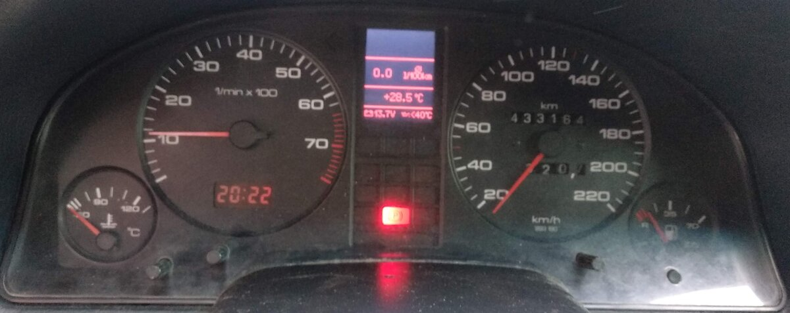
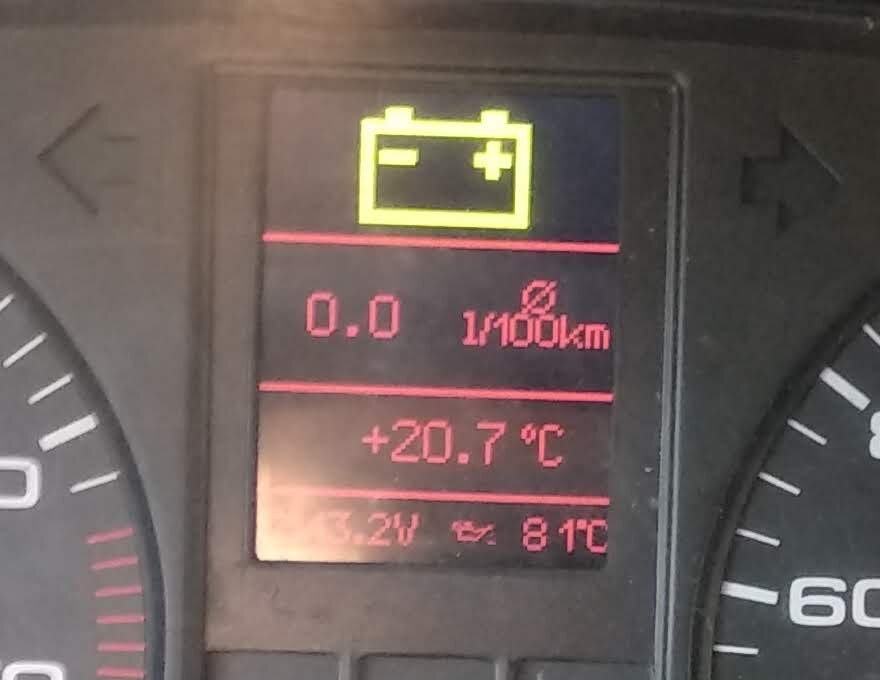
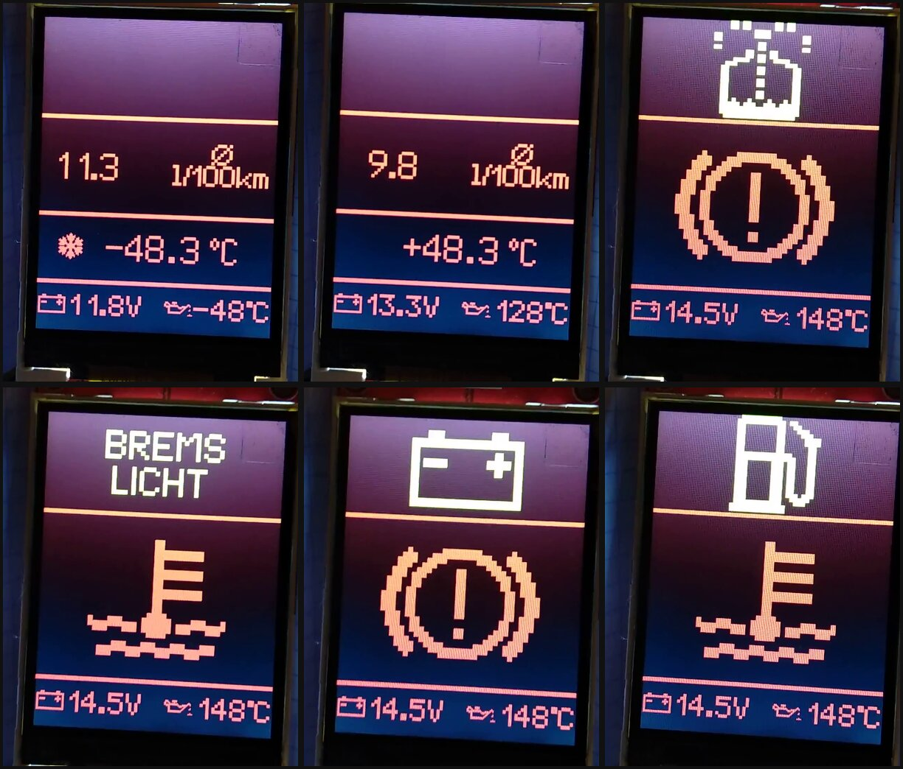
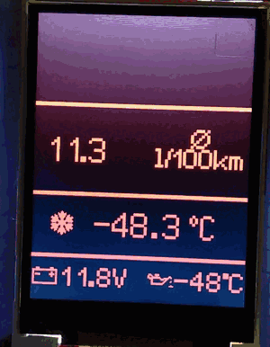
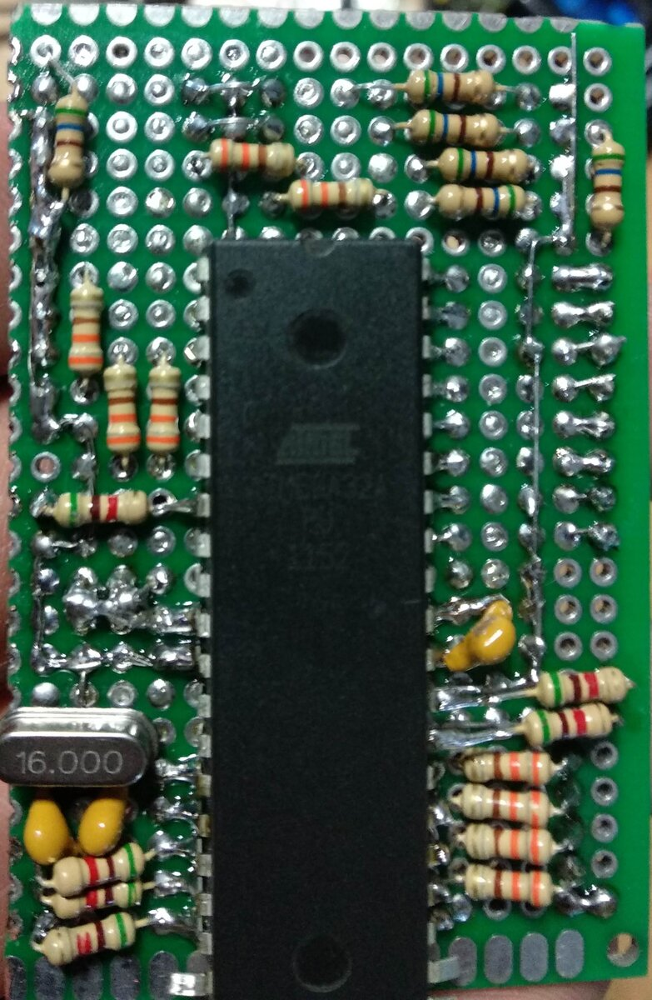
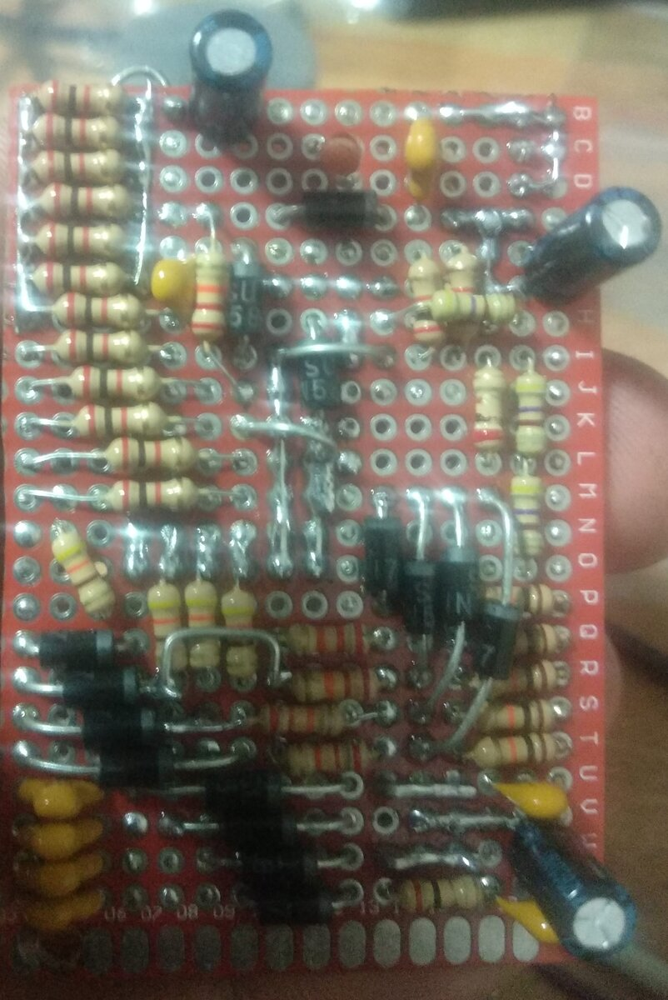
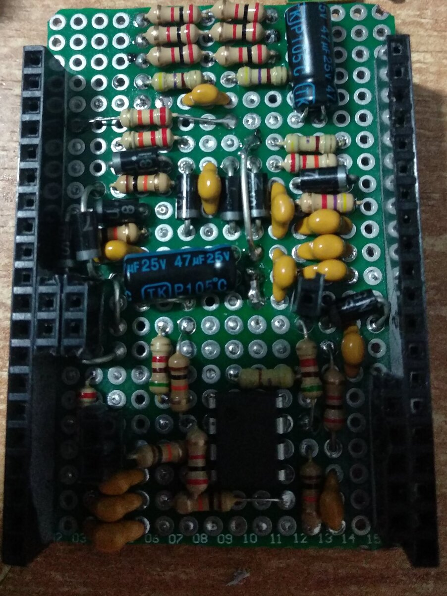
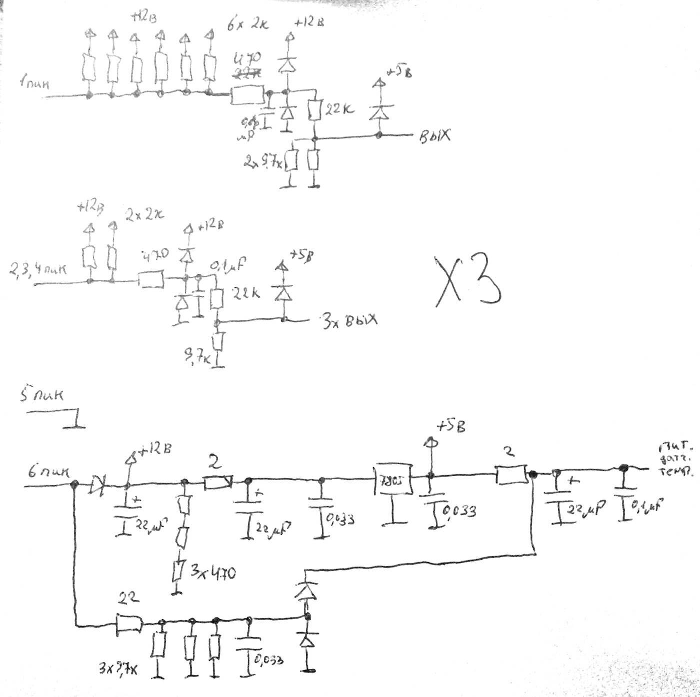

# two — бортовой компьютер для Audi 80 на ATmega32

Самодельный бортовой компьютер, встроенный в штатную приборную панель Audi 80 1987 года. Двигатель управляется ЭБУ «Январь 7.2»; компьютер читает его данные по K-Line, сам измеряет напряжение, температуру масла, наружную температуру, уровень топлива и показывает всё это на цветном TFT-экране. Устройство стабильно проработало в машине пару лет.



## Что показывает



Экран разделён на зоны:

- **Верх** — иконки предупреждений; если их несколько, они сменяют друг друга.
- **Середина** — параметр ЭБУ, выбирается кнопкой: расход топлива, длительность впрыска, угол опережения зажигания (УОЗ), коррекция времени впрыска, положение регулятора холостого хода (РХХ), обороты, положение дроссельной заслонки, состав смеси, температура охлаждающей жидкости, уровень топлива.
- **Ниже** — наружная температура (датчик DS18B20), при морозе — со снежинкой.
- **Низ** — напряжение бортовой сети и температура масла.

Предупреждения:

| Иконка | Когда |
|---|---|
| Аккумулятор | просадка напряжения: порог разный при работающем и заглушенном двигателе |
| Температура ОЖ | высокие обороты на непрогретом двигателе (пороги по температуре ОЖ и оборотам) |
| Тормозной механизм | низкий уровень тормозной жидкости |
| Антифриз | низкий уровень охлаждающей жидкости |
| Бензоколонка | мало топлива (уровень усредняется по 50 замерам) |

Прогон экрана на стенде: обычный режим и предупреждения.





## Железо

| Узел | Что используется |
|---|---|
| Микроконтроллер | ATmega32, кварц 16 МГц |
| Экран | TFT 240×320 на контроллере ILI9341, SPI |
| Связь с ЭБУ | K-Line через UART, 10400 бод |
| Наружная температура | DS18B20, 1-Wire на `PC1` |
| Напряжение, температура масла, уровень топлива | встроенный АЦП, опорное 2,56 В: `ADC6`, `ADC7`, `ADC5` |
| Дискретные входы 12 В | зажигание `PD4`, тормозная жидкость `PD2`, антифриз `PB6` |
| Кнопка | `PA3`: короткое нажатие переключает параметр ЭБУ |

Платы собраны на макетных платах:

| Плата с микроконтроллером | Входные цепи | Плата-шилд |
|---|---|---|
|  |  |  |

Схема входных цепей (рисовалась от руки): дискретные входы 12 В приводятся к 5 В делителями с защитными диодами, питание — через 7805.



## Устройство прошивки

- **Планировщик** — кооперативный, на переполнении Timer0. Задача — функция с задержкой; выполнившись, она сама ставит себя в очередь снова (`AddTask`). Главный цикл только вызывает `DispatchTask`.
- **K-Line** — протокол KWP2000. Компьютер шлёт `StartCommunication` (`81 10 F1 81 03`), затем периодически `ReadDataByLocalIdentifier` (`21 01`). Ответ разбирается побайтно в прерывании приёма UART.
- **Задачи** — опрос ЭБУ, напряжение, температура масла, наружная температура, уровень топлива, контроль зажигания, предупреждения, отрисовка.

| Файл | Что внутри |
|---|---|
| `rab/main.c` | инициализация, планировщик, приём данных ЭБУ по UART |
| `rab/task_service.c` | связь с ЭБУ, вывод параметров, кнопка, зажигание, предупреждения |
| `rab/task_volt.c`, `task_oil_tempure.c`, `task_external_tempure.c`, `task_gazoline.c` | измерения |
| `rab/lcd_low.c` | низкий уровень ILI9341 |
| `rab/lcd_hight.c` | шрифты, иконки, зоны экрана |
| `rab/tempure_sensor.c` | 1-Wire для DS18B20 |
| `rab/adc.c` | АЦП |

## Сборка

Проект AVR Studio 4 (`rab/two.aps`) с компилятором avr-gcc из WinAVR. Из командной строки:

```sh
cd rab/default
make
```

Готовая прошивка `two.hex` приложена к [релизу](../../releases).

## Известные особенности

Код остался в том виде, в каком работал в машине.

- Частота задана в разных местах по-разному: кварц 16 МГц, в `main.c` и `global_variable.h` — `F_CPU 16000000UL`, а в `Makefile` — `-DF_CPU=8000000UL`.
- Глобальные переменные определены в заголовке `global_variable.h`.
- Часть иконок (омыватель, лампы) отключена в коде.

## Лицензия

[MIT](LICENSE)
